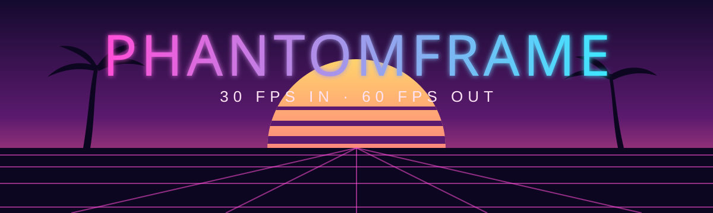

<p align="center">
  
</p>

<h3 align="center">Your console runs GTA VI at 30 FPS. Your PC shows it at 60.</h3>

<p align="center">
  Real-time, motion-compensated frame generation for console gameplay captured over HDMI.<br>
  Plug in a capture card, run one command, and cruise Leonida at a smooth 60 FPS (or 120, if you're feeling reckless).
</p>

---

## ⚡ One-line setup

```powershell
git clone https://github.com/rpatty-dev/phantomframe; cd phantomframe; pip install -r requirements.txt; python gta6_framegen.py
```

That's it. Press **F11** for fullscreen and **HOME** for settings.

> **Need:** Windows 10/11 · Python 3.10+ · a USB HDMI capture card · any GPU with OpenGL 3.3.
> **Recommended:** `winget install ffmpeg` so PhantomFrame can find your capture card by name.

---

## 🌴 What you get

| | |
|---|---|
| **60 FPS from 30 FPS** | Every real frame gets a motion-compensated in-between frame, alternating exactly 1:1. |
| **Locked frame pacing** | Output is clocked by the capture card's own 60 Hz signal, so frames land on schedule rather than "about 60 on average". |
| **120 FPS mode** *(experimental)* | 3 generated frames per real frame, for 120 Hz monitors. |
| **Fast** | Motion estimation takes about 5 ms on its own thread, and the frame building runs in a GPU shader. |
| **Image cleanup** | Removes USB capture-card compression blocks, noise and banding, then sharpens without halos. |
| **HUD-safe** | Minimap, crosshair and subtitles are protected from warping. |
| **Motion blur and smoothing** | An adjustable, cinematic look. Both can be turned off. |
| **Low-latency audio** | Passes capture-card audio straight to your speakers. |

---

## 🎮 Controls

| Key | Action |
|---|---|
| `HOME` | Settings: target FPS, mode, motion blur, sharpness, smoothing |
| `F11` | Borderless fullscreen (works with overlays) |
| `R` | Record an 8 s test clip to `recordings/` |
| `M` | Mute audio |
| `A` | Cycle audio output device |
| `Esc` | Close settings, then exit fullscreen |

---

## 📺 Best results: console settings

- **Video output: 1080p**, not 4K. Most USB cards shrink a 4K signal badly.
- **HDR: off.** Capture cards wash it out.
- **Refresh rate: 60 Hz.**
- **On the PC: set your monitor to 60 Hz or 120 Hz.** 60 doesn't divide evenly into 144 Hz, so frames would show for uneven lengths.

---

## 🧠 How it works

```
 HDMI 60 Hz ──► Capture thread ──► drop repeated frames ──► unique 30 FPS frames
                     │                                          │
                     │ timestamps every HDMI frame               ▼
                     │ as an output "tick"               Flow thread (DIS optical flow, 960×540, ~5 ms)
                     ▼                                          │
              Tick scheduler ◄──────── motion vectors ─────────┘
                     │   shows each tick after an adaptive delay (p90 flow latency)
                     ▼
           GPU shader: re-anchor vectors at the in-between moment → warp both frames toward it
                       → protect the HUD → motion blur → deblock / denoise / deband → sharpen
                     ▼
                 60 FPS on screen
```

Each unique frame from the console gives one **generated midpoint** tick, and each repeated HDMI frame gives one **real frame** tick. Output follows the capture card's own clock, so pacing stays locked to the source.

---

## 📊 Measured quality

`tools/bench.py` replays a recorded clip. It predicts every middle frame from its neighbours with the app's real pipeline and scores the result against the real frame (PSNR, higher is better). The test was fast gameplay at about 25 px of motion per frame:

| Method | PSNR |
|---|---|
| Crossfade (what cheap "motion smoothing" does) | 25.06 dB |
| PhantomFrame v1 | 25.27 dB |
| **PhantomFrame (current)** | **26.43 dB** |

```powershell
python tools/bench.py recordings/clip_XXXX.npy
```

Press `R` in the app to record your own clip.

---

## 🔧 Modes

```powershell
python gta6_framegen.py          # PhantomFrame frame generation (60 FPS default)
python gta6_framegen.py --lsfg   # clean 30 FPS passthrough, for use with Lossless Scaling's LSFG
```

---

## 🩹 Troubleshooting

| Problem | Fix |
|---|---|
| Black screen | Close and reopen. Another app may still be holding the capture card. |
| Wrong camera opens | Install ffmpeg (`winget install ffmpeg`) so the card is found by name. |
| Overlay tools stop working in fullscreen | Use `F11`. It's borderless, not exclusive fullscreen. |
| Soft or blocky image | Set the console to 1080p. A USB 2.0 card (MS2109 chip) is limited to compressed MJPEG. |
| Judder | Set the monitor to 60 or 120 Hz, not 144. |

---

<sub>PhantomFrame is an independent fan project. It is not affiliated with, endorsed by, or connected to Rockstar Games or Take-Two Interactive. Grand Theft Auto and GTA are trademarks of Take-Two Interactive Software. It works with any console or game that outputs 30 FPS over HDMI.</sub>
