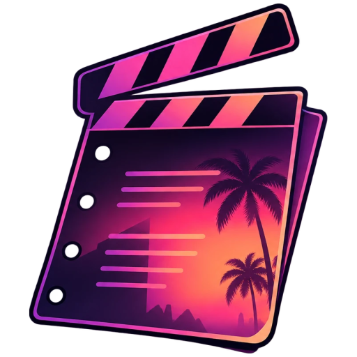

<p align="center">
  
</p>

<h1 align="center">PhantomFrame</h1>

<h3 align="center">Your console runs GTA VI at 30 FPS. Your PC shows it at 60.</h3>

<p align="center">
  Real-time, motion-compensated frame generation for console gameplay captured over HDMI.<br>
  Plug in a capture card, run one command, and cruise Leonida at a smooth 60 FPS (or 120, if you're feeling reckless).
</p>

---

## ⚡ Quick setup

### Windows

1. Plug your capture card into the PC and the console into the capture card.
2. Press **Start**, type `PowerShell` and open it.
3. Paste this line and press **Enter**:

   ```powershell
   irm https://raw.githubusercontent.com/rpatty-dev/phantomframe/main/install.ps1 | iex
   ```

4. PhantomFrame opens when the install is done. Next time, double-click **Launch.bat** in the **PhantomFrame** folder on your Desktop.

### macOS

1. Plug your capture card into the Mac and the console into the capture card.
2. Press **Cmd + Space**, type `Terminal` and open it.
3. Paste this line and press **Return**:

   ```bash
   curl -fsSL https://raw.githubusercontent.com/rpatty-dev/phantomframe/main/install.sh | bash
   ```

4. Click **Allow** when macOS asks to use the camera (the capture card counts as one). Next time, double-click **Launch.command** in the **PhantomFrame** folder, or **PhantomFrame** on your Desktop.

### Then

- **F11**: fullscreen
- **HOME** (**`\`** on Mac): settings
- Updates install automatically on launch. To force one, run the same line again. Your settings are kept.

> You don't need git, Python or admin rights: the installer downloads everything it needs.
> **Need:** Windows 10/11 or macOS · a USB HDMI capture card · any GPU with OpenGL 3.3.
> Mac: if you clicked Don't Allow, turn the camera on for Terminal in System Settings > Privacy & Security > Camera.

---

## 🌴 What you get

### Frame generation

| | |
|---|---|
| **60 FPS from 30 FPS** | Every real frame gets a motion-compensated in-between frame, alternating exactly 1:1. |
| **90 / 120 / 144 FPS targets** | 3x and 4x generation for high refresh monitors (120 is experimental). |
| **Display-locked pacing** | Frames are presented on your monitor's own refresh (DWM vblank) instead of a timer, and a phase lock keeps each frame's deadline halfway between refreshes so capture jitter can't make it skip or double. |
| **Adaptive delay** | Real frames go straight from the capture card to the screen on the next vblank; only in-between frames wait for their own motion vectors (measured publish time, not a worst-case global delay). Latency stays as low as your PC allows. |
| **Fast** | DIS optical flow at 640×360 on its own thread (about 1–2 ms), half-float conversion and pixel-buffer uploads off the render thread, frame building in a GPU shader. Real frames skip flow and motion-blur fetches entirely. |
| **Two flow presets** | ULTRAFAST (~1.7 ms) or FAST HQ (~4.2 ms, finer edges). Denser flow patches give +0.15 dB at about +1 ms. |
| **Two latency modes** | 16.6 ms hold interpolation (artifact free) or 0 ms hold hybrid extrapolation (instant). |
| **Motion smoothing** | Motion vectors are blended with the previous frame's, so moving edges don't wobble. |
| **Motion blur** | Adjustable shutter blur along the motion, for a cinematic look. |

### Made for GTA VI

| | |
|---|---|
| **Vignette removal** | Undoes GTA VI's heavy screen-edge darkening with a curve fitted on tracked points across camera pans in real gameplay. Bright sky and water near the edges are eased off so they don't wash out to white. |
| **Minimap kept true** | The minimap is drawn on top of the game's vignette, so vignette removal leaves it alone. Because the map rotates, it is crossfaded instead of warped: the best of 10 methods tested (+1.7 dB on the map, no added latency). |
| **HUD & text lock** | Crosshair, HUD and subtitles are detected and protected from warping, so text never smears. |
| **Clarity / dehaze** | Local contrast in the midtones cuts through Leonida's humid haze without crushing shadows. |
| **Vibrance** | Lifts dull colours more than already saturated ones, so skin tones stay natural. |
| **Contrast** | Optional S-curve for deeper shadows and brighter highlights. |
| **Before / after** | Press `B` to split the screen: the left half shows the image without vignette removal and grading. |

### Picture cleanup

| | |
|---|---|
| **Capture card cleanup** | A per-frame pass removes MJPEG 8×8 blocking, mosquito noise and smeared colour (colour is rebuilt along luma edges, because MJPEG stores it at reduced resolution). |
| **No flicker** | The cleanup runs once per captured frame, before generation, so real and generated frames get exactly the same cleaned image. |
| **Edge-safe sharpening** | Contrast adaptive sharpening that backs off around text and hard edges. Off by default, since the cleanup pass already gives a clean image. |

### Quality of life

| | |
|---|---|
| **Settings remember themselves** | Every control in the settings panel is saved to `settings.json` the moment you change it and restored on the next launch. |
| **Auto updates** | GitHub is checked on launch; a newer release installs itself using the same one-line installer. Disable it in settings. |
| **FPS counter** | Small top-right counter of the measured output FPS (`P` hides it). |
| **Telemetry bar** | Capture rate, console FPS, flow time and render rate (`O`). Hidden by default. |
| **Debug views** | Split screen (30 FPS vs generated) and an optical flow heatmap. |
| **Low-latency audio** | Capture card audio straight to your speakers, with output device switching. |
| **Clip recording** | Record an 8 s clip to `recordings/` for benchmarking. |

### Defaults

Tuned on real GTA VI gameplay. Change anything with `HOME` (`\` on macOS); your changes are kept.

| Setting | Default |
|---|---|
| Target | 60 FPS (2x) |
| Mode | Frame Generation (Full) |
| Latency | 16.6 ms hold interpolation |
| Flow | ULTRAFAST |
| Sharpness | 0% |
| Motion blur | 22% |
| Remove game vignette | 100% |
| Clarity / dehaze | 33% |
| Vibrance | 75% |
| Contrast | 1% |
| Motion smoothing, HUD & text lock | on |
| Telemetry bar | off |

---

## 🎮 Controls

| Key | Action |
|---|---|
| `HOME` (`\` on macOS) | Settings panel |
| `F11` / `F` | Borderless fullscreen (works with overlays) |
| `Space` | Frame generation on / off |
| `Tab` | Cycle mode: frame generation, raw passthrough, split screen, flow heatmap |
| `E` | Switch latency mode (hold interpolation / 0 ms extrapolation) |
| `Q` | Switch flow preset (ULTRAFAST / FAST HQ) |
| `S` | Cycle sharpness (0, 25, 45, 75, 100%) |
| `H` | HUD & text lock on / off |
| `B` | Before / after split |
| `P` | FPS counter on / off |
| `O` | Telemetry bar on / off |
| `R` | Record an 8 s test clip to `recordings/` |
| `M` | Mute audio |
| `A` | Cycle audio output device |
| `Esc` | Close settings, then exit fullscreen |

---

## 📺 Best results: console settings

- **Video output: 1080p**, not 4K. Most USB cards shrink a 4K signal badly.
- **HDR: off.** Capture cards wash it out.
- **Refresh rate: 60 Hz.**
- **On the PC: set your monitor to 60 Hz or 120 Hz.** 60 doesn't divide evenly into 144 Hz, so frames would show for uneven lengths.

---

## 🧠 How it works

```
 HDMI 60 Hz ──► Capture thread ──► drop repeated frames ──► unique 30 FPS frames
                     │                                          │
                     │ timestamps every HDMI frame               ▼
                     │ as an output "tick"               Flow thread (DIS optical flow, 640×360, ~1–2 ms)
                     ▼                                          │
              Tick scheduler ◄──────── motion vectors ─────────┘
                     │   real frames: next vblank · generated: own flow publish time
                     ▼
   on upload: deblock → denoise → colour edge rebuild (same clean image for real and generated frames)
                     ▼
           GPU shader: re-anchor vectors at the in-between moment → warp both frames toward it
                       → protect HUD & minimap → motion blur → sharpen → vignette removal → grading
                     ▼   presented on the display's vblank, phase locked
                 60 FPS on screen
```

Each unique frame from the console gives one **generated midpoint** tick, and each repeated HDMI frame gives one **real frame** tick. Output follows the capture card's own clock, so pacing stays locked to the source.

---

## 📊 Measured quality

`tools/bench.py` replays a recorded clip. It predicts every middle frame from its neighbours with the app's real pipeline and scores the result against the real frame (PSNR, higher is better). The test was fast gameplay at about 25 px of motion per frame:

| Method | PSNR |
|---|---|
| Crossfade (what cheap "motion smoothing" does) | 25.06 dB |
| PhantomFrame v1 | 25.27 dB |
| **PhantomFrame (current)** | **26.43 dB** |

```powershell
python tools/bench.py recordings/clip_XXXX.npy
$env:PRESET=1; python tools/bench.py recordings/clip_XXXX.npy   # score the FAST HQ flow preset
```

Press `R` in the app to record your own clip.

---

## 🔧 Modes

```powershell
python gta6_framegen.py          # PhantomFrame frame generation (60 FPS default)
python gta6_framegen.py --lsfg   # clean 30 FPS passthrough, for use with Lossless Scaling's LSFG
python gta6_framegen.py --self-test   # 4 s check that capture, shaders and rendering work
```

With `--lsfg` the picture still gets the cleanup, vignette removal and grading, with motion blur off. Click the window, press `F11`, then start LSFG in Lossless Scaling. The FPS counter is hidden there because Lossless Scaling draws its own.

---

## 🩹 Troubleshooting

| Problem | Fix |
|---|---|
| Black screen | Close and reopen. Another app may still be holding the capture card. |
| Wrong camera opens | Install ffmpeg (`winget install ffmpeg`) so the card is found by name. |
| Overlay tools stop working in fullscreen | Use `F11`. It's borderless, not exclusive fullscreen. |
| Soft or blocky image | Set the console to 1080p. A USB 2.0 card (MS2109 chip) is limited to compressed MJPEG. |
| Judder | Set the monitor to 60 or 120 Hz, not 144. |

---

<sub>PhantomFrame is an independent fan project. It is not affiliated with, endorsed by, or connected to Rockstar Games or Take-Two Interactive. Grand Theft Auto and GTA are trademarks of Take-Two Interactive Software. It works with any console or game that outputs 30 FPS over HDMI.</sub>
